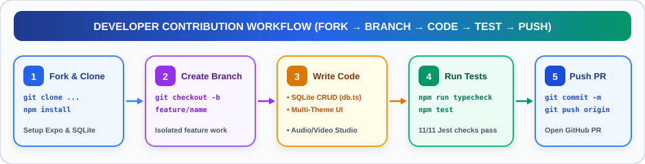
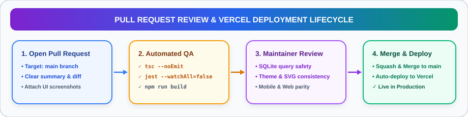

# 🤝 Contributing Guidelines

Thank you for your interest in contributing to the **Student Record Management & Multimedia Studio Application**! This document provides guidelines and best practices for submitting bug fixes, new features, and documentation improvements.

---

## 📋 Table of Contents

- [Code of Conduct](#-code-of-conduct)
- [Getting Started](#-getting-started)
- [Development Workflow](#-development-workflow)
- [Coding Standards](#-coding-standards)
- [Submitting Pull Requests](#-submitting-pull-requests)

---

## 📜 Code of Conduct

We are committed to providing a welcoming, respectful, and collaborative environment for everyone. Please read and follow our [Contributor Code of Conduct](CODE_OF_CONDUCT.md) and ensure all interactions across issues, pull requests, and discussions remain professional and constructive.

---

## 🚀 Getting Started

### Prerequisites
- **Node.js 18.x or 20.x+ (LTS)**
- **npm 9.x+**
- **Git**
- **Expo Go App** *(optional, for physical Android/iOS testing)*

### Local Development Setup

1. **Fork & Clone the Repository**:
   ```powershell
   git clone https://github.com/TheUnshackled1/Student-Record-Management-React-Native.git
   cd "Student Record Management"
   ```

2. **Install Dependencies**:
   ```powershell
   npm install
   ```

3. **Run TypeScript Type Verification**:
   ```powershell
   npm run typecheck
   ```

4. **Run the Automated Unit Test Suite**:
   ```powershell
   npm test
   ```

5. **Start the Development Server (Web Browser or Mobile)**:
   ```powershell
   # Open directly in your laptop web browser
   npx expo start --web

   # Or start Expo Metro Bundler for mobile (Expo Go / Android Emulator)
   npx expo start
   ```

6. **Verify Production Web Bundle Export**:
   ```powershell
   npm run build
   ```

---

## 🔄 Development Workflow


> ✏️ **Draw.io Source File:** [`docs/contribution_workflow.drawio`](docs/contribution_workflow.drawio) *(Editable in [Draw.io / app.diagrams.net](https://app.diagrams.net/))*

1. **Create a Feature Branch**:
   ```powershell
   git checkout -b feature/your-feature-name
   # or for bug fixes:
   git checkout -b fix/issue-description
   ```

2. **Make Your Changes**: Keep commits focused, modular, and easy to review across `src/database/`, `src/components/`, `src/screens/`, and `src/utils/`.

3. **Run Automated Tests & Typechecks**:
   Ensure all TypeScript types and Jest unit tests pass cleanly before committing:
   ```powershell
   npm run typecheck
   npm test
   ```

---

## 📐 Coding Standards

- **TypeScript & React Native**: Maintain strict TypeScript typing (`"strict": true` in `tsconfig.json`). Use functional components with typed props and React hooks (`useState`, `useEffect`, `useCallback`, `useRef`).
- **SQLite Safety & Persistence**: Always use parameterized SQL queries (`?` placeholders) via `db.runAsync` and `db.getAllAsync` in `src/database/db.ts`. Validate all user inputs through `validateStudentInput()` in `src/types/student.ts` before executing database mutations.
- **Cross-Platform Compatibility**: Keep native Android/iOS (`DatabaseContext.tsx` using `expo-sqlite`) and Web (`DatabaseContext.web.tsx`) database adapters synchronized so features run identically on mobile devices and on Vercel Web.
- **Multi-Theme UI & Iconography**: Utilize the four established color palettes (**Ocean Blue**, **Vibrant Amber**, **Royal Purple**, **Lush Emerald**) from `src/theme/palettes.ts` and custom `2.5px`-stroke vector SVG icons in `src/components/BoldIcons.tsx`.
- **Multimedia & Micro-Animations**: Trigger `playTapSoundEffect()` from `src/utils/soundEngine.ts` on interactive button taps and use React Native's `Animated` API (`Animated.spring`, `Animated.timing`) for smooth UI transitions.

---

## 📤 Submitting Pull Requests


> ✏️ **Draw.io Source File:** [`docs/pr_lifecycle.drawio`](docs/pr_lifecycle.drawio) *(Editable in [Draw.io / app.diagrams.net](https://app.diagrams.net/))*

1. Push your feature branch to your fork:
   ```powershell
   git push origin feature/your-feature-name
   ```
2. Open a **Pull Request (PR)** against the `main` branch of the official repository.
3. Provide a clear title and description explaining what your PR changes or fixes, along with mobile/web screenshots for UI changes.
4. Ensure all automated checks (`npm run typecheck`, `npm test`, and `npm run build`) pass cleanly on your branch.

Thank you for contributing to the **Student Record Management & Multimedia Studio** platform!
