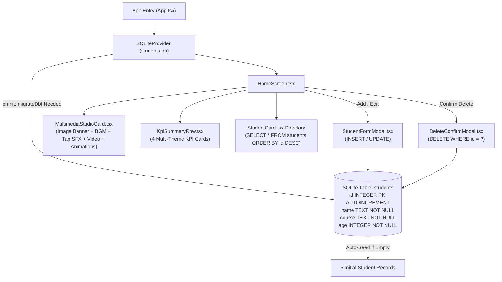
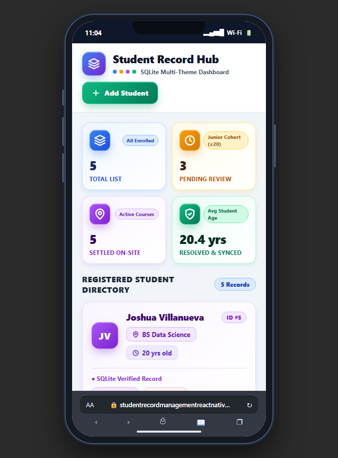
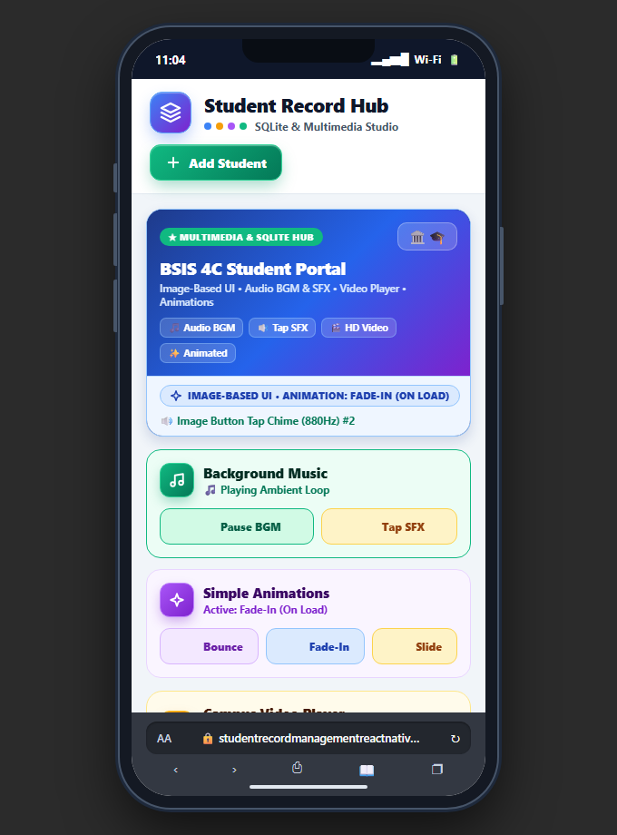
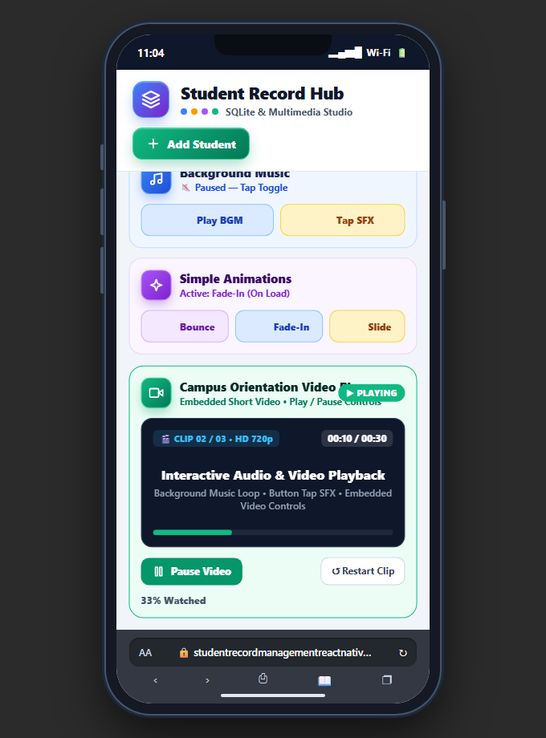
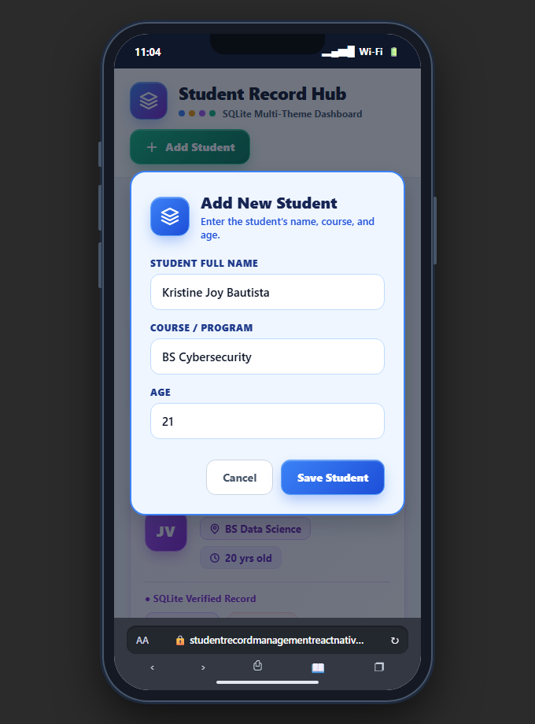

# 🎓 Student Record Management & Multimedia Studio

> **A cross-platform mobile and web application built with React Native (Expo + TypeScript) and Local SQLite (`expo-sqlite`) for BSIS 4C PROFE 8 Mobile Application Development. Designed for offline-first student record management (Add, View, Update, Delete), real-time multi-theme KPI analytics, and interactive multimedia (Image-Based UI, Background Music loop, Button Tap Sound Effects, Embedded MP4 Video Player, and Smooth React Native Micro-Animations).**

🌐 **Live Demo:** [studentrecordmanagementreactnative.vercel.app](https://studentrecordmanagementreactnative.vercel.app/)

📄 **Quick File Links:**
[](App.tsx)
[](src/database/db.ts)
[](src/components/MultimediaStudioCard.tsx)
[](src/utils/soundEngine.ts)
[](src/components/KpiSummaryRow.tsx)
[](src/theme/palettes.ts)
[](__tests__/db.test.ts)
[](documents/Student_Record_Management_Submission.pdf)
[](documents/Multimedia_Enterm_Submission.pdf)
[](vercel.json)
[](CONTRIBUTING.md)
[](CODE_OF_CONDUCT.md)
[](SECURITY.md)
[](package.json)
[](LICENSE)

[](https://reactnative.dev/)
[](https://expo.dev/)
[](https://www.typescriptlang.org/)
[](https://docs.expo.dev/versions/latest/sdk/sqlite/)
[](https://studentrecordmanagementreactnative.vercel.app/)
[](__tests__/db.test.ts)
[](LICENSE)

---

## 📋 Table of Contents

### 📌 System Overview & Core Guides
- 🔍 [Overview](#-overview)
- 🎯 [Objectives](#-objectives)
- ✨ [Core Features](#-core-features)
- 🏗️ [System Architecture](#-system-architecture)
- 🛠️ [Tech Stack](#-tech-stack)
- 🚀 [Setup & Installation](#-setup--installation)
- 🔗 [SQLite Operations & Multimedia API](#-sqlite-operations--multimedia-api)
- 🛡️ [Configuration & Platform Support](#-configuration--platform-support)
- 📁 [Project Structure](#-project-structure)
- 👨‍💻 [About](#-about)
- 📄 [License](#-license)

### 📄 Submission & Proof Documents
- 📕 [SQLite Student Record Management Report (`documents/Student_Record_Management_Submission.pdf`)](documents/Student_Record_Management_Submission.pdf)
- 📘 [SQLite Student Record Management Word Doc (`documents/Student_Record_Management_Submission.docx`)](documents/Student_Record_Management_Submission.docx)
- 📕 [Multimedia (Enterm) Implementation Proof PDF (`documents/Multimedia_Enterm_Submission.pdf`)](documents/Multimedia_Enterm_Submission.pdf)
- 📘 [Multimedia (Enterm) Implementation Proof Word Doc (`documents/Multimedia_Enterm_Submission.docx`)](documents/Multimedia_Enterm_Submission.docx)
- 🌐 [Printable HTML Reports (`submission/`)](submission/)
- 📸 [Mobile Device Output Screenshots (`submission/screenshots/`)](submission/screenshots/)
- 🤝 [Developer Contribution Guidelines (`CONTRIBUTING.md`)](CONTRIBUTING.md)
- 📜 [Contributor Code of Conduct (`CODE_OF_CONDUCT.md`)](CODE_OF_CONDUCT.md)
- 🛡️ [Security Policy & Vulnerabilities (`SECURITY.md`)](SECURITY.md)
- ⚖️ [MIT License File (`LICENSE`)](LICENSE)

---

## 🔍 Overview

Managing student records on mobile devices requires fast, offline-first persistence paired with an engaging, responsive user interface. The **Student Record Management & Multimedia Studio** is a cross-platform React Native (Expo + TypeScript) application that combines a local **SQLite (`students.db`)** database engine with an interactive **Multimedia Studio**.

The system provides four core workflows:

1. **SQLite Student Record Management (Full CRUD)** — Add, view, update, and delete student records (`id`, `name`, `course`, `age`) persisted locally in SQLite with automatic initial dataset seeding and input validation.
2. **Multi-Theme KPI Analytics Dashboard** — Four vibrant color palettes (**Ocean Blue**, **Vibrant Amber**, **Royal Purple**, **Lush Emerald**) with tinted card surfaces, complementary borders, glassmorphic gradient icon blocks, and bold `2.5px`-stroke vector SVG iconography.
3. **Interactive Multimedia Studio** — Features an illustrated **BSIS 4C Campus Image Banner**, 5 image-based action buttons, a **Background Music** play/pause loop toggle, a dual-tone `880Hz` **Button Tap Sound Effect (`SFX`)** chime on every interaction, and an **Embedded Short MP4 Video Player** with synchronized Play/Pause/Restart/Mute controls.
4. **Simple & Micro-Animations** — Screen-load **Fade-In + Slide-Up** entrance transitions, interactive **Bounce**, **Fade-In**, and **Slide** animation triggers on tap, and smooth `translateY` card lift animations on hover/press.

The result: an offline-capable, colorful, and multimedia-rich mobile application deployed live on Vercel and runnable natively on Android and iOS.

---

## 🎯 Objectives

| Goal | Description |
|---|---|
| 🗄️ **Local SQLite Persistence** | Store all student records locally on-device using `expo-sqlite` (`students.db`) with WAL journal mode and automatic initial dataset seeding. |
| 🔄 **Complete Student CRUD** | Support **Add Student**, **View Students**, **Update Student**, and **Delete Student** (with a protective confirmation modal). |
| 🎨 **Multi-Theme UI/UX** | Replace generic two-color cards with four rich color themes (Blue, Amber, Purple, Emerald), gradient icon blocks, and bold `2.5px` SVG icons. |
| 🖼️ **Image-Based UI** | Integrate an illustrated **BSIS 4C Student Portal** campus image banner, custom badge icons, and image-based quick-action buttons. |
| 🎵 **Audio & Video Playback** | Provide a toggle button for ambient background music, a short sound effect on every button tap, and an embedded short MP4 video player with play/pause controls. |
| ✨ **Smooth Animations** | Apply Fade-In and Slide-Up animations on screen load and interactive Bounce, Fade, and Slide animations on button tap. |

---

## ✨ Core Features

### 🗂️ Student Record Directory & SQLite CRUD
- **Add Student** — Modal form (`StudentFormModal.tsx`) to enter a student's **Full Name**, **Course / Program**, and **Age** with strict validation (`1–120` integer age, non-empty trimmed strings).
- **View Students** — Scrollable directory displaying all registered students ordered by newest first (`ORDER BY id DESC`) with pull-to-refresh and one-tap **Load Sample Data** recovery.
- **Update Student** — Pre-populates the modal with an existing student's details and executes `UPDATE students SET name = ?, course = ?, age = ? WHERE id = ?`.
- **Delete Student** — Displays a dedicated confirmation dialog (`DeleteConfirmModal.tsx`) before executing `DELETE FROM students WHERE id = ?`.
- **Auto-Seeded SQLite Database** — Automatically seeds 5 realistic student records on first launch when `students.db` is empty.

### 📊 Multi-Theme KPI Summary Dashboard
- **Total List (Ocean Blue Theme)** — Multi-layered polygon stack icon (`strokeWidth: 2.5`) showing total enrolled students in SQLite.
- **Pending Review (Vibrant Amber Theme)** — Bold clock indicator icon tracking the junior student cohort (`age ≤ 20`).
- **Settled On-Site (Royal Purple Theme)** — Distinctive map-pin icon counting active distinct degree programs/courses.
- **Resolved & Synced (Lush Emerald Theme)** — Premium checkmark shield icon calculating the live average student age across all SQLite records.

### 🎬 Multimedia Studio (Image-Based UI, Audio & Video)
- **Illustrated Campus Image Banner** — High-resolution vector campus banner (`CAMPUS_BANNER_URI`) with academic crest badges and status pills.
- **Image-Based Action Buttons** — Five tactile buttons featuring embedded thumbnail artwork (`Play/Pause BGM`, `Tap SFX`, `Bounce`, `Fade-In`, `Slide`).
- **Background Music Toggle (`BGM`)** — Play/Pause toggle button (`toggleBackgroundMusic()`) driving a real-time ambient chord progression loop with live status feedback (`🎵 Playing Ambient Loop` / `🔇 Paused`).
- **Button Tap Sound Effect (`SFX`)** — Automatic dual-tone chime (`587.33Hz D5 → 880Hz A5`) triggered via `playTapSoundEffect()` whenever any button in the app is tapped, paired with a live visual toast (`🔊 Image Button Tap Chime (880Hz)`).
- **Embedded Short Video Player** — 16:9 embedded HTML5 `<video>` player (`mov_bbb.mp4`) with a circular center **Play / Pause** overlay button, animated audio waveform bars, bottom **Play Video / Pause Video** and **Restart** controls, **Audio Mute** toggle, progress scrubber bar, and live timecode (`00:06 / 00:10`).

### ✨ Interactive Animations & Micro-Interactions
- **Screen-Load Entrance Animation** — `Animated.parallel` combining opacity **Fade-In** and vertical **Slide-Up** spring physics on initial render.
- **On-Tap Animation Triggers** — Dedicated buttons to trigger **Bounce Effect** (`Animated.spring` scale pulse), **Fade Pulse** (`Animated.timing` opacity), and **Slide Motion** (`Animated.spring` horizontal translation).
- **Card Hover & Press Lift** — Every KPI card and student card smoothly lifts (`translateY: -4px`) with a deepened complementary border and diffused theme shadow on hover or press.

---

## 🏗️ System Architecture

### Overall Application & SQLite Data Flow



### Mobile Application Output Preview

| SQLite Dashboard & KPI Cards | Multimedia Studio & BGM Audio | Embedded Video Player (Playing) | Add Student SQLite Modal |
| :---: | :---: | :---: | :---: |
|  |  |  |  |

---

## 🛠️ Tech Stack

| Layer / Feature | Technology & Tools | Description |
|---|---|---|
| **Mobile Framework** | React Native 0.76.5 & Expo SDK 52 | Cross-platform native mobile (Android/iOS) and web runtime |
| **Language** | TypeScript 5.3 (`strict: true`) | Type-safe models, SQLite contracts, and component props |
| **Local Database (Native)** | `expo-sqlite` 15.1.4 | On-device native SQLite database engine (`SQLiteProvider` & `useSQLiteContext`) |
| **Local Database (Web)** | `DatabaseContext.web.tsx` | Platform-specific Web SQLite adapter persisting the `students` table in browser storage |
| **Audio Engine** | Web Audio API (`soundEngine.ts`) | Zero-dependency synthesizer for looping ambient BGM and 880Hz button tap SFX chimes |
| **Video Player** | HTML5 `<video>` & Media Controls | Embedded 16:9 MP4 video stream with custom Play/Pause, Restart, Mute & Scrubber dock |
| **Animation Engine** | React Native `Animated` API | Hardware-accelerated `Animated.spring`, `Animated.timing` & `Animated.parallel` transitions |
| **Theme & Styling** | Multi-Theme `StyleSheet` (`palettes.ts`) | Four dynamic palettes (Blue, Amber, Purple, Emerald) with linear gradients & diffused shadows |
| **Iconography** | Custom Vector SVGs (`BoldIcons.tsx`) | Hand-crafted `2.5px`-stroke vector icons inside rounded glassmorphic gradient blocks |
| **Unit Testing** | Jest 29.7 & `ts-jest` | Automated unit test suite covering SQLite CRUD, auto-seeding, validation & multimedia |
| **Cloud Hosting** | Vercel (`vercel.json`) | Production static web hosting with SPA rewrite rules |

---

## 🚀 Setup & Installation

> Detailed step-by-step guide for setting up and running the project on **Windows**, **macOS**, or **Linux**.

### ✅ Prerequisites

| Tool | Minimum Version | Download |
|---|---|---|
| **Node.js** | 18.x or 20.x+ (LTS) | [nodejs.org](https://nodejs.org/) |
| **npm** | 9.x+ | Bundled with Node.js |
| **Git** | Any | [git-scm.com](https://git-scm.com/) |
| **Expo Go** *(Optional)* | Latest (Android / iOS) | Google Play Store / Apple App Store |

---

### 1. Clone the Repository

```powershell
git clone https://github.com/TheUnshackled1/Student-Record-Management-UsingReactNative.git
cd "Student-Record-Management-UsingReactNative"
```

---

### 2. Install Dependencies

```powershell
npm install
```

This installs:
- **Expo SDK 52 & React Native 0.76.5** (`expo`, `react`, `react-native`, `expo-status-bar`, `expo-asset`)
- **SQLite Engine** (`expo-sqlite`)
- **Expo Web Runtime** (`react-dom`, `react-native-web`, `@expo/metro-runtime`)
- **TypeScript & Jest Test Suite** (`typescript`, `jest`, `ts-jest`, `@types/react`, `@types/jest`)

---

### 3. Start the Development Server (Laptop Browser or Mobile)

```powershell
# Launch directly in your laptop web browser
npx expo start --web

# Or launch the Expo Metro bundler for mobile (Expo Go / Android Emulator)
npx expo start
```

- Press **`w`** in the terminal to open in your web browser (`http://localhost:8081`).
- Press **`a`** to open on an Android Emulator, or scan the QR code with the **Expo Go** app on your phone.

---

### 4. Run Automated Tests & TypeScript Verification

```powershell
# Run strict TypeScript typecheck
npm run typecheck

# Run the Jest unit test suite (11 tests)
npm test
```

---

### 5. Build Production Web Bundle for Vercel

```powershell
npm run build
```

Exports the production static bundle into the `dist/` directory configured in [`vercel.json`](vercel.json).

---

## 🔗 SQLite Operations & Multimedia API

| Category | Function / Action | SQL Query / Engine Implementation | Source File | Description |
|---|---|---|---|---|
| **SQLite Init** | `migrateDbIfNeeded(db)` | `CREATE TABLE IF NOT EXISTS students (id INTEGER PRIMARY KEY AUTOINCREMENT, name TEXT NOT NULL, course TEXT NOT NULL, age INTEGER NOT NULL);` | `src/database/db.ts` | Enables WAL mode, creates `students` table, and seeds 5 initial records if empty |
| **SQLite Seed** | `seedSampleStudents(db)` | Loops `INITIAL_STUDENTS` via `addStudent(db, student)` | `src/database/db.ts` | Populates 5 default student records across CS, IT, IS, CpE, and Data Science |
| **SQLite Read** | `getAllStudents(db)` | `SELECT id, name, course, age FROM students ORDER BY id DESC;` | `src/database/db.ts` | Fetches all registered students ordered from newest to oldest |
| **SQLite Create** | `addStudent(db, input)` | `INSERT INTO students (name, course, age) VALUES (?, ?, ?);` | `src/database/db.ts` | Inserts a validated student record and returns `lastInsertRowId` |
| **SQLite Update** | `updateStudent(db, id, input)` | `UPDATE students SET name = ?, course = ?, age = ? WHERE id = ?;` | `src/database/db.ts` | Updates an existing student's name, course, and age by primary key `id` |
| **SQLite Delete** | `deleteStudent(db, id)` | `DELETE FROM students WHERE id = ?;` | `src/database/db.ts` | Permanently removes a student record after confirmation modal approval |
| **Validation** | `validateStudentInput(...)` | Trims strings & checks `Number.isInteger(age)` in range `1..120` | `src/types/student.ts` | Validates form inputs before executing SQLite `INSERT` or `UPDATE` |
| **Audio BGM** | `toggleBackgroundMusic()` | Web Audio API triangle-wave ambient arpeggio loop (`480ms` interval) | `src/utils/soundEngine.ts` | Toggles background study music ON/OFF from the `Play BGM / Pause BGM` button |
| **Audio SFX** | `playTapSoundEffect(label)` | Web Audio API dual-tone sine chime (`587.33Hz D5 → 880Hz A5`, `150ms`) | `src/utils/soundEngine.ts` | Plays a crisp UI sound effect on every button tap and updates the SFX status banner |
| **Video Player** | `handleToggleVideo()` | HTML5 `<video>` `play()` / `pause()` + timecode & waveform sync | `src/components/MultimediaStudioCard.tsx` | Controls the embedded 16:9 MP4 video player, center play overlay, and progress bar |
| **Animations** | `triggerBounceAnimation()` | `Animated.spring` / `Animated.timing` (`scale`, `opacity`, `translateX/Y`) | `src/components/MultimediaStudioCard.tsx` | Executes screen-load Fade-In and interactive Bounce, Fade-In, and Slide animations |

---

## 🛡️ Configuration & Platform Support

| Setting / Feature | Default / Engine | Configuration / Behavior |
|---|---|---|
| **Database Name** | `students.db` | Configured on `<SQLiteProvider databaseName="students.db" onInit={migrateDbIfNeeded}>` in `App.tsx`. |
| **Native Mobile SQLite** | `expo-sqlite` (`DatabaseContext.tsx`) | Uses native Android/iOS on-device SQLite binaries with WAL journaling. |
| **Web Browser SQLite** | `DatabaseContext.web.tsx` | Automatically resolved by Metro on Web; executes the same SQL CRUD operations backed by `localStorage`. |
| **Input Validation** | Enforced (`validateStudentInput`) | Prevents empty names/courses and non-integer or out-of-range ages (`1–120`) from reaching SQLite. |
| **Delete Protection** | `DeleteConfirmModal.tsx` | Requires explicit user confirmation (`Confirm Delete` vs `Keep Record`) before running `DELETE`. |
| **Theme Assignment** | Deterministic (`getStudentTheme`) | Hashes student ID and course code across `blue`, `amber`, `purple`, and `emerald` palettes. |
| **Vercel SPA Routing** | `vercel.json` (`outputDirectory: "dist"`) | Builds with `npm run build` (`expo export --platform web`) and rewrites `/(.*)` to `/index.html`. |

---

## 📁 Project Structure

```text
📦 Student Record Management/
├── 📂 __tests__/                  🧪 Automated Jest Unit Test Suite
│   └── 🧪 db.test.ts              # 11 unit tests for SQLite CRUD, auto-seeding, validation, themes & multimedia
├── 📂 documents/                  📑 Compiled Academic Submission Documents (PDF & Word)
│   ├── 📕 Multimedia_Enterm_Submission.pdf          # Multimedia (Enterm) mobile proof report (PDF)
│   ├── 📘 Multimedia_Enterm_Submission.docx         # Multimedia (Enterm) mobile proof report (Word)
│   ├── 📕 Student_Record_Management_Submission.pdf  # SQLite Student Record Management report (PDF)
│   └── 📘 Student_Record_Management_Submission.docx # SQLite Student Record Management report (Word)
├── 📂 docs/                       📐 Draw.io Architecture & Workflow Vector Diagrams
│   ├── 📐 conduct_enforcement.drawio.svg            # Code of Conduct 4-tier enforcement SVG diagram
│   ├── 📐 conduct_enforcement.drawio                # Editable Draw.io source for conduct enforcement
│   ├── 📐 contribution_workflow.drawio.svg          # Developer contribution workflow SVG diagram
│   ├── 📐 contribution_workflow.drawio              # Editable Draw.io source for contribution workflow
│   ├── 📐 pr_lifecycle.drawio.svg                   # Pull Request review lifecycle SVG diagram
│   ├── 📐 pr_lifecycle.drawio                       # Editable Draw.io source for PR lifecycle
│   ├── 📐 security_architecture.drawio.svg          # 4-layer Security Architecture SVG diagram
│   └── 📐 security_architecture.drawio              # Editable Draw.io source for security architecture
├── 📂 src/                        ⚛️ Application Source Code (TypeScript + React Native)
│   ├── 📂 components/             🧩 Reusable UI, Multimedia & Modal Components
│   │   ├── 🎨 BoldIcons.tsx                 # Custom 2.5px-stroke vector SVG icons (Layers, Clock, MapPin, Shield, Audio, Video)
│   │   ├── 🛡️ DeleteConfirmModal.tsx        # Protective confirmation modal before SQLite DELETE
│   │   ├── 📊 KpiSummaryRow.tsx             # 4 Multi-Theme KPI summary cards with hover/press lift animations
│   │   ├── 🎬 MultimediaStudioCard.tsx      # Image Banner, Image Buttons, BGM Toggle, Tap SFX, MP4 Video Player & Animations
│   │   ├── 🗂️ StudentCard.tsx               # Multi-theme student record card with gradient icon block & badges
│   │   └── 📝 StudentFormModal.tsx          # Add / Update student modal form with validation banner
│   ├── 📂 database/               🗄️ SQLite Database Layer & Platform Providers
│   │   ├── 🗄️ db.ts                         # SQLite table migration, initial student seeding & async CRUD queries
│   │   ├── 📱 DatabaseContext.tsx           # Native Android/iOS SQLiteProvider re-export (expo-sqlite)
│   │   └── 🌐 DatabaseContext.web.tsx       # Web SQLiteProvider adapter for laptop browser & Vercel deployment
│   ├── 📂 screens/                📱 Application Screens
│   │   └── 🏠 HomeScreen.tsx                # Main dashboard integrating Header, Multimedia Studio, KPIs & SQLite Directory
│   ├── 📂 theme/                  🎨 Multi-Theme Design System
│   │   └── 🎨 palettes.ts                   # Ocean Blue, Vibrant Amber, Royal Purple & Lush Emerald theme definitions
│   ├── 📂 types/                  📐 TypeScript Interfaces & Validators
│   │   └── 📐 student.ts                    # Student, StudentInput interfaces & validateStudentInput()
│   └── 📂 utils/                  🔊 Audio & Asset Utilities
│       └── 🎵 soundEngine.ts                # Web Audio BGM loop, 880Hz tap SFX chime & SVG data URI image assets
├── 📂 submission/                 📸 Generated HTML Reports & Mobile Frame Screenshots
│   ├── 📂 screenshots/            📱 iPhone Mobile-Framed Output Screenshots
│   │   ├── 📸 01_view_students_dashboard.png
│   │   ├── 📸 02_view_students_directory.png
│   │   ├── 📸 03_add_student_modal.png
│   │   ├── 📸 04_add_student_result.png
│   │   ├── 📸 05_update_student_modal.png
│   │   ├── 📸 06_update_student_result.png
│   │   ├── 📸 07_delete_student_confirm.png
│   │   ├── 📸 08_delete_student_result.png
│   │   ├── 📸 mm_01_image_banner_entrance.png
│   │   ├── 📸 mm_02_audio_bgm_playing_sfx.png
│   │   ├── 📸 mm_03_video_player_playing.png
│   │   ├── 📸 mm_04_video_player_paused.png
│   │   ├── 📸 mm_05_simple_animation_bounce.png
│   │   └── 📸 mm_06_integrated_sqlite_directory.png
│   ├── 🌐 Multimedia_Enterm_Report.html             # Printable HTML source for Multimedia submission
│   └── 🌐 Student_Record_Management_Report.html     # Printable HTML source for SQLite submission
├── 📱 App.tsx                     # Root application component wrapping HomeScreen in SQLiteProvider
├── 🚀 index.ts                    # Expo root component registration entry point
├── ⚙️ app.json                    # Expo project configuration & expo-sqlite plugin
├── 🌐 vercel.json                 # Vercel static web build & SPA routing configuration
├── 🧪 jest.config.js              # Jest & ts-jest test runner configuration
├── 📐 tsconfig.json               # Strict TypeScript compiler configuration
├── 📦 package.json                # Project scripts, dependencies & devDependencies
├── 🤝 CONTRIBUTING.md             # Developer contribution guidelines & PR workflow
├── 📜 CODE_OF_CONDUCT.md          # Contributor Covenant v2.1 Code of Conduct
├── 🛡️ SECURITY.md                 # Security policy & vulnerability reporting guide
├── ⚖️ LICENSE                     # MIT License
└── 📄 README.md                   # Project documentation
```

---

## 👨‍💻 About

### The Project

The **Student Record Management & Multimedia Studio Application** was developed for **BSIS 4C — PROFE 8 Mobile Application Development**. It demonstrates how a modern React Native (Expo + TypeScript) codebase can combine offline-first **SQLite database persistence (`expo-sqlite`)** with a vibrant **Multi-Theme UI** and interactive **Multimedia features** (Image-Based UI, Background Music synthesis, Button Tap Sound Effects, Embedded Video Playback, and Smooth Animations).

### Live Deployment

The mobile web build is continuously deployed and publicly accessible on Vercel at **[studentrecordmanagementreactnative.vercel.app](https://studentrecordmanagementreactnative.vercel.app/)**.

---

## 📄 License

This project is licensed under the **MIT License** — see the [LICENSE](LICENSE) file for full details.

```text
MIT License

Copyright (c) 2026 John Tyrone Pagunsan Coronel (TheUnshackled1) — https://github.com/TheUnshackled1

Permission is hereby granted, free of charge, to any person obtaining a copy
of this software and associated documentation files (the "Software"), to deal
in the Software without restriction, including without limitation the rights
to use, copy, modify, merge, publish, distribute, sublicense, and/or sell
copies of the Software, and to permit persons to whom the Software is
furnished to do so, subject to the following conditions:

The above copyright notice and this permission notice shall be included in all
copies or substantial portions of the Software.

THE SOFTWARE IS PROVIDED "AS IS", WITHOUT WARRANTY OF ANY KIND, EXPRESS OR
IMPLIED, INCLUDING BUT NOT LIMITED TO THE WARRANTIES OF MERCHANTABILITY,
FITNESS FOR A PARTICULAR PURPOSE AND NONINFRINGEMENT.
```
