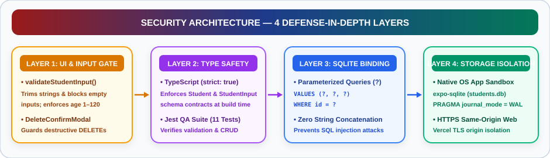

# 🛡️ Security Policy

> Security policy and vulnerability reporting guidelines for the **Student Record Management & Multimedia Studio Application**.

---

## 📋 Supported Versions

The table below details which versions of the application currently receive security updates and bug fixes:

| Version | Supported | Minimum Node.js | Expo SDK | React Native |
|---|---|---|---|---|
| `1.0.x` | ✅ Yes | `18.x / 20.x+` | `52.0+` | `0.76.5+` |
| `< 1.0` | ❌ No | — | — | — |

---

## 🔒 Reporting a Vulnerability

The security of the **Student Record Management & Multimedia Studio Application** and its stored student records is a top priority.

If you discover a security vulnerability or suspect a security flaw within the application:

1. **Do NOT open a public GitHub issue** or publicly disclose the vulnerability.
2. **Email the Security Team privately**: Send a detailed report to the project maintainer at `jtcoronel.chmsu@gmail.com` or contact the **Information Systems (BSIS) / Management Information Systems (MIS) Department**.
3. **Include Key Details**:
   - Type of issue (e.g., SQL Injection, Input Validation Bypass, Client-Side Storage Exposure, XSS in Web Build, Dependency Vulnerability).
   - Step-by-step instructions or proof-of-concept to reproduce the issue.
   - Affected components, database functions (`src/database/db.ts`), or screens (`src/screens/HomeScreen.tsx`).

### ⏱️ Response Timeline

- **Acknowledgment**: Within 24 hours of receipt.
- **Assessment & Triage**: Within 48 hours.
- **Patch & Fix Release**: Critical fixes released within 7 days.

---

## 🛡️ Built-in Security Measures

> ✏️ **Draw.io Source File:** [`docs/security_architecture.drawio`](docs/security_architecture.drawio) *(Editable in [Draw.io / app.diagrams.net](https://app.diagrams.net/))*

The application enforces multiple defense-in-depth security controls out of the box:

- **Parameterized SQLite Prepared Statements**: 100% of `INSERT`, `UPDATE`, and `DELETE` operations in [`src/database/db.ts`](src/database/db.ts) use parameterized `?` placeholders via `db.runAsync(...)`, eliminating SQL injection vectors.
- **Strict Input Validation & Sanitization**: [`validateStudentInput()`](src/types/student.ts) trims leading/trailing whitespace, rejects empty student names or courses, and enforces strict integer bounds (`1–120`) on student age before any SQLite query executes.
- **Destructive Action Confirmation Gate**: [`DeleteConfirmModal.tsx`](src/components/DeleteConfirmModal.tsx) intercepts all delete requests with an explicit confirmation modal (`Confirm Delete` vs `Keep Record`) to prevent accidental or unauthorized record deletion.
- **Compile-Time TypeScript Safety**: Strict TypeScript checking (`"strict": true` in [`tsconfig.json`](tsconfig.json)) prevents null/undefined coercion and enforces strict `Student` and `StudentInput` data contracts across all layers.
- **Sandboxed On-Device & Origin-Scoped Storage**:
  - On **Android & iOS**, [`DatabaseContext.tsx`](src/database/DatabaseContext.tsx) stores `students.db` inside the OS-sandboxed application directory using `expo-sqlite` with Write-Ahead Logging (`PRAGMA journal_mode = WAL;`).
  - On **Web (Vercel)**, [`DatabaseContext.web.tsx`](src/database/DatabaseContext.web.tsx) isolates student records under the browser's HTTPS Same-Origin Policy (`https://studentrecordmanagementreactnative.vercel.app/`).
- **Automated Regression & Security Verification**: The Jest unit test suite ([`__tests__/db.test.ts`](__tests__/db.test.ts)) continuously verifies parameterized SQL bindings, input validation rejection rules, and database seeding integrity.

---

## 📜 Disclosure Policy

We follow a **Responsible Disclosure** process. Once a reported vulnerability is fixed and verified, security advisories will be published alongside updated patch releases and deployed to Vercel production.
